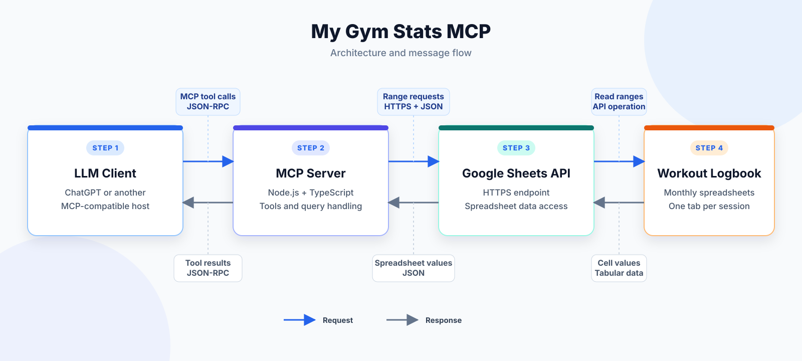

# My Gym Stats MCP

I love working out, and I have kept a logbook since I started training. It tracks my progress, including the weight lifted and the number of sets and repetitions performed.

The logbook is stored in Google Drive as a collection of Google Sheets. Each spreadsheet covers one month, with a separate tab for every training session.

This project makes that data accessible to an LLM client—ChatGPT, in my case. The client sends requests to a Node.js MCP server, which reads the logbook through the Google Sheets API and returns the requested information.

  

## Tech Stack

| Technology | Role |
| --- | --- |
| **Node.js** | Server runtime |
| **TypeScript** | Type-safe application code |
| **Model Context Protocol (MCP)** | Communication between the LLM client and the server |
| **Google Sheets API** | Access to workout data stored in Google Sheets |
| **JSON-RPC** | Message format used by MCP |
